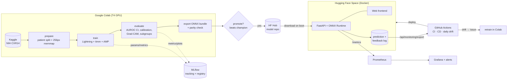

# 🫁 LungLens: Explainable Chest X-ray Triage, from Training to Monitored Production

[](https://github.com/dhiman-13/chest-xray-triage/actions/workflows/ci.yml)
[](https://colab.research.google.com/github/dhiman-13/chest-xray-triage/blob/main/notebooks/colab_train.ipynb)
[](https://huggingface.co/spaces/dhimanjatin/lunglens)

A deep-learning system that reads a frontal chest radiograph, scores **14 thoracic findings**, explains each prediction with a **heatmap**, and sorts studies into **urgent / review / routine** so a radiologist's worklist reads the critical cases first. It is built and run like a production ML service: versioned data, tracked experiments, a model registry with a quality gate, CI/CD, a containerised API with a web frontend, and live monitoring with drift detection.

> ⚠️ Research prototype, **not a medical device**. Not for clinical use.

<!-- After training, replace with your screenshot: docs/screenshot.png -->

---

## Highlights

| Area | What is done | Why it matters |
|---|---|---|
| **Data** | NIH ChestX-ray14 (112k images, 30k patients). **Patient-level** official split. Memory-mapped cache for fast loading on Colab | Splitting by image leaks patients into the test set and inflates AUROC |
| **Model** | DenseNet-121 (CheXNet backbone), EfficientNet-B3 and ConvNeXt-T via `timm`. Transfer learning, mixed precision, class-weighted BCE / focal loss | 14-label imbalanced problem (Hernia is 0.2%) |
| **Evaluation** | Per-class AUROC with **95% bootstrap CIs**, AUPRC, sensitivity @ 90% specificity, **calibration (ECE + temperature scaling)**, **subgroup analysis** (sex/age/view), **Grad-CAM**, comparison with published baselines | Shows the work meets research standards, not just a single accuracy number |
| **Decision policy** | Per-class thresholds tuned for **90% sensitivity** on validation data. Urgent findings drive triage | Missing a pneumothorax costs far more than an extra read |
| **MLOps** | Hydra configs, **MLflow** tracking + **Model Registry** (challenger/champion aliases, auto-promotion gate), **DVC** pipeline, **GitHub Actions** CI (lint, tests, end-to-end smoke pipeline, Docker build) and CD | Reproducible and automated |
| **Serving** | **ONNX Runtime** + FastAPI (no torch in the image). Calibration and CAM heatmaps baked into the ONNX graph. Model pulled from the HF Hub on boot | Small, fast, CPU-only container, no training/serving skew |
| **Frontend** | Single-page app: drag-and-drop, interactive heatmap per finding, triage banner, radiologist feedback, monitoring dashboard, model card | Usable by a clinician, not only by an engineer |
| **Monitoring** | Prometheus metrics, Grafana dashboard + alert rules, SQLite prediction/feedback log (no images stored), **daily drift job** (PSI + KS) that opens a GitHub issue to recommend retraining | Detects model failure after deployment |

## Architecture



## Results

Run the notebook, then paste `reports/RESULTS.md` here. Template:

| Model | Macro AUROC (95% CI) | Urgent-findings AUROC | ECE before → after calibration |
|---|---|---|---|
| Wang et al. 2017 (same official split) | 0.738 | – | – |
| **DenseNet-121 (this work)** | _0.8xx (0.8xx–0.8xx)_ | _…_ | _… → …_ |
| EfficientNet-B3 (this work) | _…_ | _…_ | _…_ |

Figures generated automatically: ROC curves, AUROC vs. published baselines, reliability diagram, Grad-CAM examples (`reports/figures/`).

## Quick start

### 1. Train on Google Colab (T4)
Open [`notebooks/colab_train.ipynb`](notebooks/colab_train.ipynb) in Colab, select the **T4 GPU** runtime and run the cells top to bottom. It downloads the data, trains, evaluates, exports, registers, and deploys. Everything is persisted to your Google Drive.

### 2. Run the app locally
```bash
pip install -r requirements-serve.txt
# put a bundle in serving/model_store (from Colab: MyDrive/cxr-triage/bundle), or set HF_MODEL_REPO
uvicorn serving.app.main:app --port 7860      # open http://localhost:7860
```

### 3. Full monitoring stack (Docker)
```bash
cd monitoring && docker compose up --build
# app :8000 · Prometheus :9090 · Grafana :3000
```

### 4. Test the whole pipeline on a laptop (no GPU, no dataset)
```bash
pip install torch torchvision --index-url https://download.pytorch.org/whl/cpu
pip install -r requirements-dev.txt && pip install -e .
make smoke      # synthetic data → train → evaluate → export → API, ~2 min on CPU
pytest -q
```

## Project structure
```
configs/              Hydra configs (model/, data/, training hyper-parameters)
src/cxr/
  data/               prepare_nih.py · splits.py (patient-level) · dataset.py · synthetic.py
  models/             classifier.py (LightningModule) · losses.py (weighted BCE, focal)
  preprocess.py       ONE preprocessing path shared by training and serving
  train.py            training entry point (MLflow logging, checkpoints, early stopping)
  evaluate.py         research-grade evaluation + figures + RESULTS.md
  metrics.py          AUROC/AUPRC, bootstrap CI, sens@spec, ECE, temperature scaling
  explain.py          Grad-CAM
  export.py           ONNX bundle (calibrated probs + CAM in one graph)
  registry.py         MLflow registry: register / promote (quality gate) / pull / publish
serving/
  app/                FastAPI (main.py), ONNX inference, Prometheus + SQLite telemetry
  frontend/           web UI (HTML/CSS/JS, no build step)
  Dockerfile
monitoring/           Prometheus, alert rules, Grafana dashboard, drift_report.py
deploy/               Hugging Face Space deployment
.github/workflows/    ci.yml · cd.yml · drift-monitor.yml
notebooks/            colab_train.ipynb
tests/                unit, API and leakage tests
```

## Design decisions
* **Patient-level splitting** using the official NIH test list, with an assertion in code that fails on any patient overlap.
* **Thresholds are chosen on validation, metrics are reported on test.** Temperature scaling is fit on validation only, so the test set is touched exactly once.
* **Training/serving parity:** `cxr/preprocess.py` is the only resize/normalise code, used by the evaluation dataset *and* the API. ONNX output is checked against PyTorch at export.
* **Privacy by design:** the API never writes images to disk. It logs probabilities and label-free image statistics only.
* **Monitoring without labels:** ground truth arrives late in radiology, so the system watches input drift, prediction drift and radiologist feedback as proxies.

## Limitations and next steps
* NIH labels are NLP-mined from reports (estimated >90% accurate) and include known label noise. Hernia has very few positives, so its CI is wide.
* Single-institution training data. **External validation** (CheXpert, PadChest, or Indian hospital data such as AIIMS) is needed before any claim of generalisation.
* Next: self-supervised pre-training on unlabeled CXRs, multi-view input, lesion localisation using the NIH bounding boxes, uncertainty estimation (MC-dropout / deep ensembles), and federated fine-tuning across hospitals.

## References
Wang et al., *ChestX-ray8*, CVPR 2017 · Rajpurkar et al., *CheXNet*, 2017 · Huang et al., *DenseNet*, CVPR 2017 · Guo et al., *On Calibration of Modern Neural Networks*, ICML 2017 · Selvaraju et al., *Grad-CAM*, ICCV 2017 · Lin et al., *Focal Loss*, ICCV 2017
